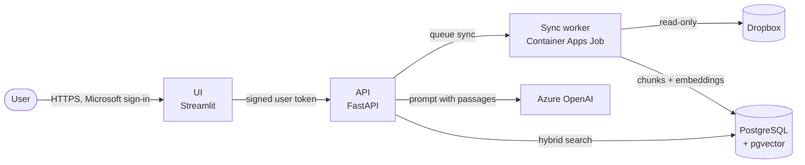

# RAG Showcase

A document assistant built on **retrieval-augmented generation (RAG)**: connect a Dropbox folder, ask questions in plain language, and get answers that cite the passages they are based on. Each user sees only their own documents.

It is a compact, working reference for a RAG system: hybrid search on PostgreSQL/pgvector, citation checks, multi-user isolation and a low-cost Azure deployment that scales to zero. Status: **v2.1.0**, small private pilot, not production-hardened.

## Try it

1. **Get an invite link:** contact the repository owner ([@adranale](https://github.com/adranale)).
2. **Open the link and sign in** with a personal Microsoft account (outlook.com, hotmail.com, live.com, …). Work/school accounts are not supported yet.
3. **Request access** (optionally with a short message). After the admin approves, reload the page.
4. **My documents** → *Connect Dropbox* (read-only access) → enter a folder such as `/Documents/notes` → *Save folder* → *Sync now*.
5. **Chat** → ask a question. Answers cite their sources (`[S1]`, `[S2]`, …); *View passages in context* shows the cited text.

Good to know:
- The first request after a quiet period can take 1–3 minutes: the apps scale to zero and the database is stopped when idle. The UI retries for you.
- Supported files: PDF, TXT, Markdown, Word (`.docx`), Excel (`.xlsx`), PowerPoint (`.pptx`); up to 2000 files per sync.
- You can disconnect Dropbox and delete all your indexed documents at any time (*My documents* → *Remove data*). The operator has technical access to the database; see [limitations](docs/multi-user.md#limitations-read-before-inviting-people).

## Tech stack

| Area | Technology |
|---|---|
| Backend | Python 3.12, FastAPI, Pydantic |
| UI | Streamlit (Microsoft sign-in) |
| Vector store | PostgreSQL 16 + pgvector, full-text search |
| Embeddings | sentence-transformers (`paraphrase-multilingual-MiniLM-L12-v2`, CPU) |
| LLM | Azure OpenAI `gpt-4.1-mini` (Ollama `llama3.2:3b` locally) |
| Documents | Dropbox API (OAuth, read-only); pypdf, python-docx, openpyxl, python-pptx; optional OCR with Azure Document Intelligence |
| Hosting | Docker, Azure Container Apps, Azure Database for PostgreSQL, GitHub Actions (OIDC) |
| Tests | pytest, Ruff |

## How it works



**Indexing.** The sync worker lists the user's Dropbox folder, downloads only new or changed files, extracts the text, splits it into chunks and embeds each chunk. Chunks and vectors are stored in PostgreSQL, tagged with the user's ID.

**Answering.**
1. The question is embedded with the same model.
2. Hybrid search combines three rankings with reciprocal rank fusion: vector similarity, keyword search and file/folder-name matches.
3. The top passages go to the LLM, which must answer in JSON and cite passage IDs.
4. The API rejects answers whose citations do not match the supplied passages; if the documents do not contain the answer, it says so.

**Isolation and access.** PostgreSQL row-level security plus `user_id` filters keep users' data apart. New users join through an invite link and an access request that an admin approves in the app. Dropbox tokens are stored encrypted.

**Cost.** The apps scale to zero; an idle job stops PostgreSQL after 30 minutes and the API starts it again on demand.

## Repository layout

| Path | Content |
|---|---|
| `app/` | FastAPI app: routes (`main.py`), search, generation, users, access requests, Dropbox OAuth, sync jobs |
| `chat_ui.py`, `ui_helpers.py`, `ui_start.py` | Streamlit UI |
| `connectors/` | Dropbox / Google Drive sources, text extraction, OCR, chunking, change tracking |
| `sync_worker.py`, `embed_chunks.py` | Per-user sync and embedding |
| `sql/` | Database schema and migrations (applied by `init_db.py`) |
| `deploy/`, `.github/workflows/` | Azure deployment scripts and CI/CD |
| `tests/`, `evaluation/` | Tests and retrieval evaluation |

## Run locally

Needs Python 3.12, Docker and, for answers, [Ollama](https://ollama.com) with `llama3.2:3b`.

```powershell
python -m venv .venv; .\.venv\Scripts\Activate.ps1
pip install -r requirements-dev.txt
docker compose up -d db                  # PostgreSQL + pgvector on localhost:5432
python init_db.py; python ingest_text.py; python embed_chunks.py   # sample data
uvicorn app.main:app --reload            # API docs: http://127.0.0.1:8000/docs
pytest                                   # some tests need the database
```

`docker compose up` starts database, API and UI together; sign-in and Dropbox need app registrations and secrets in `.env` (see [multi-user setup](docs/multi-user.md#local-setup)).

## More documentation

- [Multi-user mode](docs/multi-user.md): isolation, login, invite links, API endpoints, local setup, limitations
- [Ingestion](docs/ingestion.md): command-line ingestion from local files, Dropbox or Google Drive, OCR, change tracking
- [Azure deployment](docs/deployment.md): architecture, provisioning, multi-user upgrade, auto-stop, security, cost, cleanup
- [Security policy](SECURITY.md)

Releases are tagged `vX.Y.Z` on `main` (see GitHub releases); `main` is kept stable.
