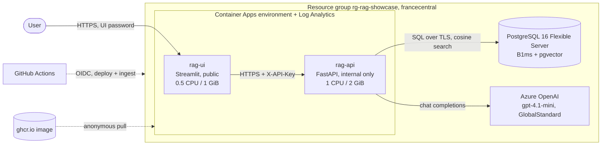

# RAG Showcase

RAG Showcase is a lightweight Retrieval-Augmented Generation (RAG) application for searching and asking questions about internal documents. It is built with Python 3.12, FastAPI, PostgreSQL with the pgvector extension, and sentence-transformers for embeddings.

The project is currently in early pre-release status and focuses on a document assistant pattern suitable for enterprise knowledge bases backed by local or cloud document stores.

## What this project does

- Stores document chunks in a vector database
- Embeds queries and matches relevant passages
- Returns grounded search results via a FastAPI API
- Answers questions using retrieved passages and an LLM provider
- Includes sample local documents for testing and evaluation

## Current API

The application exposes the following endpoints:

- `GET /health` — basic service health check
- `GET /ready` — checks database availability and pgvector extension
- `POST /search` — retrieve the most relevant document chunks for a question
- `POST /chat` — retrieve relevant passages and generate a cited answer

## Architecture

- `app/main.py` — FastAPI app and route definitions
- `app/db.py` — database connection helpers
- `app/search.py` — embedding and vector search logic
- `app/generation.py` — answer generation from retrieved context
- `data/sample/` — sample documents used for local development
- `tests/` — API and generation tests
- `evaluation/` — evaluation scripts and result output

## Local development

### Prerequisites

- Python 3.12
- PostgreSQL with the `vector` extension enabled
- Ollama installed and running if you want answer generation

### Setup

On Windows PowerShell:

```powershell
cd C:\Gothaer\code\github\adranale\rag-showcase
.\.venv\Scripts\Activate.ps1
pip install -r requirements.txt
```

### Run the API

```powershell
uvicorn app.main:app --reload
```

Then open:

- http://127.0.0.1:8000/docs for the FastAPI Swagger UI
- http://127.0.0.1:8000/health for the health endpoint

## Environment and secrets

This project expects configuration through environment variables or a local `.env` file (git-ignored). Keep secrets out of source control.

Typical configuration includes:

- database connection settings
- LLM provider credentials or local model configuration
- optional cloud connector credentials for Google Drive or Dropbox

## Data and privacy

- `data/private/` is reserved for local private content and is git-ignored
- Do not commit API keys, OAuth tokens, or document contents to the repository
- Follow the least-privilege OAuth model for external integrations

## Example usage

Search for relevant passages:

```bash
curl -X POST "http://127.0.0.1:8000/search" \
  -H "Content-Type: application/json" \
  -d '{"question":"What is the volunteer handbook policy?","top_k":3}'
```

Generate an answer from retrieved context:

```bash
curl -X POST "http://127.0.0.1:8000/chat" \
  -H "Content-Type: application/json" \
  -d '{"question":"What is the volunteer handbook policy?","top_k":3}'
```

## Azure deployment: architecture, frameworks and processes

This section describes what the `azure-deployment` branch adds on top of the local application. The step-by-step commands follow in "Deploy to Azure".

### Architecture



| Component | Role |
|---|---|
| `rag-ui` (Streamlit, `chat_ui.py`) | Only public endpoint. Password login (`APP_PASSWORD`), forwards questions to the API with the shared `X-API-Key`. |
| `rag-api` (FastAPI, `app/`) | Internal ingress only. Embeds the question locally, runs the pgvector search, calls Azure OpenAI, validates the citations and returns the answer. |
| PostgreSQL Flexible Server | Stores `documents`, `chunks` and the embeddings (`vector` extension, cosine distance). TLS is required. |
| Azure OpenAI | Generates the cited JSON answer (`GENERATION_PROVIDER=azure_openai`). |
| Embeddings | `sentence-transformers` on CPU inside the container image; the model is baked into the image so scale-from-zero does not download it. |
| Container Apps environment | Hosts both apps (0–1 replicas, scale to zero) and sends logs to Log Analytics. |
| `ghcr.io/adranale/rag-showcase` | One image for both apps. The UI overrides the start command; the default `CMD` serves FastAPI on `0.0.0.0:8000`. |

### Technical frameworks

| Area | Technology |
|---|---|
| Language / API | Python 3.12, FastAPI, Uvicorn, Pydantic |
| UI | Streamlit |
| Retrieval | PostgreSQL 16 + pgvector, `sentence-transformers` (CPU torch wheels), psycopg |
| Generation | Azure OpenAI chat completions (Ollama for local use) |
| Container | Docker (`python:3.12-slim`, non-root user, `linux/amd64`) |
| Hosting | Azure Container Apps, Azure Database for PostgreSQL Flexible Server, Azure OpenAI |
| Automation | PowerShell 7 + Azure CLI (`deploy/azure.ps1`), GitHub Actions with OIDC |
| Tests | pytest (`tests/test_deploy_script.py` checks the script and workflows without Azure) |

### Request flow
1. The user logs in to the UI and asks a question.
2. The UI calls `POST /chat` on the internal API (HTTPS, `X-API-Key`).
3. The API embeds the question, searches `chunks` (only rows with the current `embedding_model` and `ingestion_status = 'indexed'`) and builds a prompt from the top passages, which are treated as untrusted.
4. Azure OpenAI returns JSON; the API requires `citation_ids` to be a non-empty subset of the supplied `S<n>` IDs that includes every inline `[S<n>]`, otherwise it answers with an error (502). Insufficient evidence returns no citations.
5. The UI shows the answer with its sources.

### Processes
- **Image build** (`build-image.yml`): builds `linux/amd64` on pushes to `main` / `azure-deployment` that touch the app, `Dockerfile`, `requirements.txt` or the workflow, and pushes `ghcr.io/adranale/rag-showcase:<full-commit-sha>`. Deployments use the immutable SHA tag; `latest` only comes from `main`.
- **Preflight** (`deploy/azure.ps1 -PreflightOnly`): creates nothing. Checks tools, the explicitly given subscription, region, PostgreSQL restriction, names, image pullability and platform, and OpenAI model/SKU quota. `-ProbePostgres` proves PostgreSQL can really be created by creating and deleting a throwaway server.
- **Provisioning** (`deploy/azure.ps1`, or the `Deploy to Azure` workflow): resource group → PostgreSQL + `VECTOR` extension + database + firewall → Azure OpenAI account and deployment → Container Apps environment → API app (internal) → UI app (public). Generated secrets are saved to `.env.azure` first, never printed, and stored as Container Apps secrets. Every `az` call goes through a helper that adds `--subscription`, uses a safe operation label and redacts secrets in errors.
- **Ingestion**: `init_db.py` → `ingest_text.py` → `embed_chunks.py` against the database, either from your machine (needs outbound port 5432) or with the `Ingest sample data (Azure)` workflow, which opens a temporary firewall rule for the runner and always removes it.
- **Authentication to Azure from CI**: OIDC federated credential bound to the `azure-test` GitHub environment, which requires a reviewer's approval for every run. No Azure password is stored in GitHub.
- **Teardown**: manual only (see Cleanup).
- **Idle auto-stop** (optional, `deploy/azure-autostop.ps1`): a scheduled job stops PostgreSQL after 30 idle minutes; the API starts it again on demand (managed identities, Contributor on the server only).

### Lessons from the first deployments
- PostgreSQL availability is subscription- and region-specific. `az postgres flexible-server list-skus` can report a size as available even though creation fails with `SkuNotAvailable`, and ARM validation does not catch it. This subscription could not create PostgreSQL in `westeurope` or `swedencentral`, which is why the default is `francecentral` and why `-ProbePostgres` exists.
- Azure OpenAI quota is per model, SKU and region. `gpt-4.1-mini` with `GlobalStandard` had free quota in `francecentral`; `gpt-4o-mini` did not.
- Azure CLI argument names for `db create` and firewall rules differ between versions; the scripts try both forms.
- A deleted PostgreSQL server name can stay reserved for a few minutes.
- Calls such as reading an app FQDN can fail transiently; the script retries such errors and can be re-run safely (resume mode).

### Known limitations
Prototype, sample data only, **not production-hardened**: the API uses the database administrator account, PostgreSQL allows all Azure services, secrets are visible as command arguments while `az` runs, there are no budget alerts, and a cold start after idle takes about 30–60 s. The Azure CLI `containerapp exec` command can drop its connection; if it does, use the UI to verify.

## Deploy to Azure (small test deployment, sample data only)

Architecture: PostgreSQL Flexible Server (Burstable B1ms, pgvector) + Azure OpenAI (`gpt-4.1-mini`, GlobalStandard deployment of 10K capacity, i.e. processed in Azure's global pool; default region `francecentral`; override with `-OpenAiModel`/`-OpenAiSku`/`-Location`) + two Azure Container Apps (internal API, public password-protected UI) that scale to zero. Embeddings stay local (CPU) inside the image. This is a prototype, **not production-hardened**.

Commands below use PowerShell 7 (`pwsh`) on macOS (`brew install powershell azure-cli`); run them from the repository root.

### 1. Image
The `Build image` workflow builds `linux/amd64` and pushes `ghcr.io/adranale/rag-showcase:<full-commit-sha>` for every push to `main` / `azure-deployment` that touches the app, `Dockerfile`, `requirements.txt` or the workflow (run it manually via *workflow_dispatch* otherwise). `latest` is only updated from `main`. The script defaults to the image of your current commit; pass `-Image ghcr.io/adranale/rag-showcase:<sha>` to use another one. After the first run set the package to **Public** (GitHub → Packages → Package settings), because Container Apps pull anonymously. The image contains no secrets.

### 2. Safe checks (create nothing)
```powershell
az login
az account list --output table          # pick the NGO subscription ID
pwsh ./deploy/azure.ps1 -SubscriptionId <subscription-id> -Suffix <unique-lowercase-id> -PreflightOnly
```
Preflight verifies the subscription (name, ID, tenant, resource group and region are shown), tools, region, whether PostgreSQL is restricted for your subscription in that region, resource names, image pullability and `linux/amd64`, and the OpenAI model/SKU (quota is checked when Azure exposes it). The default preflight is read-only. Azure's SKU list can report a PostgreSQL size as available even though the subscription cannot create it (`SkuNotAvailable`); add `-ProbePostgres` to create and immediately delete a throwaway server in a temporary resource group (a few cents, several minutes) as a real proof. Anything it cannot verify is listed as a manual check. It never switches model, region or SKU for you. The script never infers NGO funding from a subscription name: check grant/credit coverage, balance and expiry in Azure billing yourself.

### 3. Provision (creates billable resources)
```powershell
pwsh ./deploy/azure.ps1 -SubscriptionId <subscription-id> -Suffix <unique-lowercase-id>
```
It asks for confirmation and the UI password, writes the generated credentials to the git-ignored `.env.azure` (mode 600) **before** creating anything, stores them as Container Apps secrets and never prints them.

**Safe to re-run (resume mode).** The script detects which resources already exist in the resource group (PostgreSQL, Azure OpenAI account and deployment, Container Apps environment, API and UI apps) and only creates what is missing, so a run that failed halfway (for example on a transient Azure error) can simply be repeated with the same `-SubscriptionId`, `-Suffix` and `-Image`:
- **Credentials are never rotated.** They are reused from `.env.azure`, or, if the file is absent (for example after a CI run), read from the secrets of the existing `rag-api` app. `.env.azure` is never overwritten. If the PostgreSQL server exists but no credentials can be found, the script stops with recovery steps instead of resetting the admin password.
- **Existing apps** are only moved to the given `-Image`; their secrets and settings (including the UI password and the auto-stop settings) are left unchanged. The UI password is only asked for when the UI app has to be created. To change it: `az containerapp secret set`.
- A **stopped PostgreSQL server** (idle auto-stop) is started first.
- **Transient Azure errors** (`InternalServerError`, throttling, a just-deleted server name that is still reserved) are retried up to 3 times with a pause.
- A name that resolves but is **not** in your resource group is reported as taken (choose another `-Suffix`). Quota is not re-checked for a deployment that already exists.
- Resume mode only reconciles what the script created; it does not repair resources you changed by hand, change the region, or resize existing resources. The local ingestion firewall rule `allow-my-ip` is created again on every run; remove it afterwards.

### 4. Initialise and ingest sample data
```powershell
python3.12 -m venv .venv
. .venv/bin/Activate.ps1
pip install -r requirements.txt
$env:DATABASE_URL = ((Get-Content .env.azure | Where-Object { $_ -like 'DATABASE_URL=*' }) -split '=', 2)[1]
python init_db.py       # applies sql/*.sql incl. CREATE EXTENSION vector
python ingest_text.py   # data/sample only
python embed_chunks.py  # downloads the embedding model on first run
```
Do not run `ingest_pdfs.py` / `reindex_all.sh` against Azure unless the PDFs are meant to be public (`data/private/` is personal). When ingestion is done, remove your local firewall rule (the command is printed by the script):
```powershell
az postgres flexible-server firewall-rule delete --resource-group rg-rag-showcase --name pg-rag-<suffix> --rule-name allow-my-ip --subscription <subscription-id> --yes
```

### 5. Verify
- **UI / login / generation:** open the printed `https://…azurecontainerapps.io` URL, log in, ask e.g. “Can volunteers claim travel costs?”. A cited answer confirms UI → API (HTTPS, `X-API-Key`), retrieval and Azure OpenAI together. The first request after idle takes about 30–60 s (cold start).
- **API `/health`, `/ready`, `/search` (internal ingress only, no public `curl`):** run inside the UI container, which has `API_KEY` and `RAG_API_BASE_URL` set:
  ```powershell
  az containerapp exec --resource-group rg-rag-showcase --name rag-ui --subscription <subscription-id> `
    --command "python -c \"import os,httpx;b=os.environ['RAG_API_BASE_URL'];h={'X-API-Key':os.environ['API_KEY']};print(httpx.get(b+'/health').json(),httpx.get(b+'/ready').json(),httpx.post(b+'/search',headers=h,json={'question':'travel costs'}).json()['count'])\""
  ```
  (`/ready` shows `vector_extension` only after `init_db.py` ran.)

### Deploy from GitHub Actions (alternative to steps 2–4)
The `Deploy to Azure` workflow (manual *Run workflow*) runs the same script, then initialises the DB and ingests the sample data, then removes the CI firewall rule. It signs in with OIDC (no stored Azure password). `preflight_only` is on by default; untick it to create resources. `probe_postgres` (preflight only) runs the `-ProbePostgres` check.

If provisioning succeeded but the ingestion step did not run or failed (for example a transient Azure error), do not re-provision: run the manual `Ingest sample data (Azure)` workflow with the same `suffix`. It reads the connection string from the `rag-api` app's `db-url` secret, opens a temporary firewall rule for the runner, runs `init_db.py`, `ingest_text.py` and `embed_chunks.py`, and always removes the rule again. This also works when port 5432 is blocked on your own network.

One-time setup:
```powershell
$sub = '<subscription-id>'
az ad app create --display-name rag-showcase-github --query appId -o tsv        # -> <client-id>
az ad sp create --id <client-id>
az role assignment create --assignee <client-id> --role Contributor --scope /subscriptions/$sub
az ad app federated-credential create --id <client-id> --parameters '{"name":"github-azure-test","issuer":"https://token.actions.githubusercontent.com","subject":"<subject>","audiences":["api://AzureADTokenExchange"]}'
```
`<subject>` is `repo:adranale/rag-showcase:environment:azure-test`. If the login fails with `AADSTS700213` and the error shows a different subject, the repository uses ID-based OIDC claims (`repo:<owner>@<owner-id>/<repo>@<repo-id>:environment:azure-test`): use exactly the subject shown in that error message.
In GitHub: Settings → Environments → create `azure-test` (add yourself as required reviewer), and add these **environment secrets**:

| Secret | Value |
|---|---|
| `AZURE_CLIENT_ID` | app registration (client) ID from above |
| `AZURE_TENANT_ID` | Azure tenant ID |
| `AZURE_SUBSCRIPTION_ID` | the NGO subscription ID |
| `RAG_UI_PASSWORD` | UI login password (8–64 chars: letters, digits, `. _ ~ + @ #` or `-`) |

The credentials generated in CI are discarded with the runner. Retrieve them later from the Container Apps secrets (`az containerapp secret show --name rag-api --resource-group <rg> --secret-name db-url --show-values`). The workflow runs the same script, so it is resumable too: after a failed run, run it again with the same `suffix` and it continues with what is missing, taking the credentials from the existing `rag-api` secrets. Deleting the resource group is only needed to start from scratch. To delete it from GitHub, run the **Destroy Azure deployment** workflow (same `azure-test` environment/approval; you must retype the resource group name to confirm).

### Idle auto-stop and on-demand start (optional, saves the PostgreSQL cost)
Container Apps already scale to zero and start with the first request. PostgreSQL does not (it is the main cost, billed per hour while running). `deploy/azure-autostop.ps1` adds, to an existing deployment:
- the scheduled Container Apps Job `rag-idle-stop` (every 10 minutes, UTC) that runs `idle_stop.py`: it stops the server when `rag-api` received **no requests in the last 30 minutes** (`-IdleMinutes`) and the server has been up for about that long (a freshly started server, e.g. for an ingestion run, gets a grace period based on its CPU metric history). If the metric check fails it does nothing (fail closed). Azure also restarts a stopped server by itself after 7 days; the job stops it again.
- a wake-up in the API (`app/wake.py`): when the database cannot be reached and `POSTGRES_RESOURCE_ID` is set, the API asks Azure to start the server (at most once a minute) and answers `503` with “database is starting, retry in 1–3 minutes”, which the UI shows. The first question after a stop therefore needs one retry.

```powershell
pwsh ./deploy/azure-autostop.ps1 -SubscriptionId <subscription-id> -Suffix <suffix> -Image ghcr.io/adranale/rag-showcase:<commit-sha>
```
The image must be built from a commit that contains `app/wake.py` and `idle_stop.py` (the `Build image` workflow does this for `azure-deployment`). The script is safe to re-run. It restarts `rag-api` with that image, enables system-assigned managed identities (no stored credentials) and grants them **Contributor on the PostgreSQL server only** (start/stop) plus **Monitoring Reader on `rag-api`** (job). Creating role assignments needs *Owner*, *User Access Administrator* or *Role Based Access Control Administrator*; the CI identity has only *Contributor*, so run this script yourself with `az login` (or grant that role to the CI identity first). Role assignments can take a few minutes to apply.

Notes: the job does not know about direct database use. After a manual start (for example ingestion from your machine) the server is stopped 30–40 minutes later unless the API receives requests; the `Ingest sample data (Azure)` workflow does not start a stopped server either, so start it first (`az postgres flexible-server start --name pg-rag-<suffix> --resource-group rg-rag-showcase --subscription <subscription-id>`). A stopped server still bills for its storage. To remove the feature: `az containerapp job delete --name rag-idle-stop --resource-group rg-rag-showcase --subscription <subscription-id>` and remove `POSTGRES_RESOURCE_ID` from `rag-api`. Verified on the test deployment: the job stopped the server after 30 idle minutes, the next question returned the "database is starting" message, and a retry a few minutes later gave a cited answer.

### Security and networking notes
- PostgreSQL is created with `--public-access 0.0.0.0`, Azure's “allow Azure services” rule: **any resource in any Azure tenant** may attempt to connect. Access still requires the credentials; TLS is required (`require_secure_transport=on`, `sslmode=require`). Your machine gets a single `/32` rule (`allow-my-ip`) for ingestion; delete it afterwards.
- The API connects with the PostgreSQL administrator (`ragadmin`), and the same account is used for schema creation and ingestion. A separate least-privilege runtime role is a recommended follow-up, not implemented. Private networking (VNet/private endpoints) would add cost and complexity and is not used.
- The API is internal-only and requires the `X-API-Key`; the public UI requires the password. Secrets are passed to `az` as arguments (visible in the local process list while it runs).

### Cost notes
- The OpenAI deployment capacity is a **rate/quota limit, not a monetary budget**. Budget alerts in Cost Management only **notify**; they do not stop spending.
- Scaling Container Apps to zero does not make the idle deployment free: PostgreSQL (compute and 32 GiB storage), the OpenAI account, Log Analytics/logging and other resources are billed separately. Stopping PostgreSQL (manually, or automatically with the idle auto-stop above) removes the compute charge but not the storage charge. No price estimate is given here; check Azure pricing and your NGO credit terms.

### Cleanup
This deletes **everything** in the resource group, including the database and its data. Be sure the name is the resource group created by this script:
```powershell
az group delete --name rg-rag-showcase --subscription <subscription-id>
rm .env.azure
```

Settings: `GENERATION_PROVIDER` (`ollama` default, or `azure_openai`), `API_KEY` (optional; enforces the `X-API-Key` header on `/search` and `/chat`), `APP_PASSWORD` (optional UI password). See `.env.azure.example`.

## Repository conventions

- Use async route handlers for I/O-bound work
- Prefer type hints and Pydantic models
- Keep route handlers thin and move logic into modules under `app/`
- Validate with pytest when adding functionality

## Release status

This repository is currently tagged as a pre-release:

- `v0.1.0-pre-release`

The `main` branch is kept stable while ongoing work continues on the `dev` branch.

## Project status

This is an early-stage showcase and is intended to demonstrate a practical RAG implementation for document retrieval and answer generation. It is not yet production-hardened and should be treated as a development-focused reference project.

