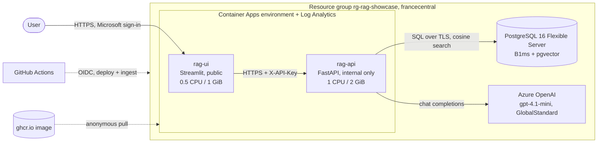

# Azure deployment

The Azure deployment is set up in two steps: the [base deployment](#base-deployment-deployazureps1) (`deploy/azure.ps1`: PostgreSQL, Azure OpenAI, API and UI apps) and the [upgrade to multi-user mode](#upgrade-to-multi-user-mode-v2) (`deploy/azure-multiuser.ps1`: Microsoft sign-in, per-user Dropbox sync). Run the upgrade right after the base deployment; the base script alone still creates the v1-style UI with a shared password. Optional: [idle auto-stop](#idle-auto-stop-and-on-demand-start-optional-saves-the-postgresql-cost) of PostgreSQL. This is a prototype, **not production-hardened**.

## Architecture, frameworks and processes

### Architecture



| Component | Role |
|---|---|
| `rag-ui` (Streamlit, `ui/chat.py`, started by `ui/start.py`) | Only public endpoint. Microsoft login (`st.login`), then forwards calls to the API with a short-lived signed user token plus the shared `X-API-Key`. |
| `rag-api` (FastAPI, `app/`) | Internal ingress only. Embeds the question locally, runs the pgvector search, calls Azure OpenAI, validates the citations and returns the answer. |
| PostgreSQL Flexible Server | Stores `documents`, `chunks` and the embeddings (`vector` extension, cosine distance). TLS is required. |
| Azure OpenAI | Generates the cited JSON answer (`GENERATION_PROVIDER=azure_openai`). |
| Embeddings | `sentence-transformers` on CPU inside the container image; the model is baked into the image so scale-from-zero does not download it. |
| Container Apps environment | Hosts both apps (0–1 replicas, scale to zero) and sends logs to Log Analytics. |
| `ghcr.io/adranale/rag-showcase` | One image for both apps. The UI overrides the start command; the default `CMD` serves FastAPI on `0.0.0.0:8000`. |

### Technical frameworks

| Area | Technology |
|---|---|
| Language / API | Python 3.12, FastAPI, Uvicorn, Pydantic |
| UI | Streamlit |
| Retrieval | PostgreSQL 16 + pgvector, `sentence-transformers` (CPU torch wheels), psycopg |
| Generation | Azure OpenAI chat completions (Ollama for local use) |
| Container | Docker (`python:3.12-slim`, non-root user, `linux/amd64`) |
| Hosting | Azure Container Apps, Azure Database for PostgreSQL Flexible Server, Azure OpenAI |
| Automation | PowerShell 7 + Azure CLI (`deploy/azure.ps1`), GitHub Actions with OIDC |
| Tests | pytest (`tests/test_deploy_script.py` checks the script and workflows without Azure) |

### Request flow
1. The user logs in to the UI and asks a question.
2. The UI calls `POST /chat` on the internal API (HTTPS, `X-API-Key`).
3. The API embeds the question, searches `chunks` (only rows with the current `embedding_model` and `ingestion_status = 'indexed'`) and builds a prompt from the top passages, which are treated as untrusted.
4. Azure OpenAI returns JSON; the API requires `citation_ids` to be a non-empty subset of the supplied `S<n>` IDs that includes every inline `[S<n>]`, otherwise it answers with an error (502). Insufficient evidence returns no citations.
5. The UI shows the answer with its sources.

### Processes
- **Image build and deploy** (`build-and-deploy-image.yml`): builds `linux/amd64` on pushes to `main` / `azure-deployment` that touch the app, `Dockerfile`, `requirements.txt` or the workflow, and pushes `ghcr.io/adranale/rag-showcase:<full-commit-sha>`. Deployments use the immutable SHA tag; `latest` only comes from `main`.
- **Preflight** (`deploy/azure.ps1 -PreflightOnly`): creates nothing. Checks tools, the explicitly given subscription, region, PostgreSQL restriction, names, image pullability and platform, and OpenAI model/SKU quota. `-ProbePostgres` proves PostgreSQL can really be created by creating and deleting a throwaway server.
- **Provisioning** (`deploy/azure.ps1`, run locally by a subscription owner): resource group → PostgreSQL + `VECTOR` extension + database + firewall → Azure OpenAI account and deployment → Container Apps environment → API app (internal) → UI app (public). Generated secrets are saved to `.env.azure` first, never printed, and stored as Container Apps secrets. Every `az` call goes through a helper that adds `--subscription`, uses a safe operation label and redacts secrets in errors.
- **Ingestion**: `ops.init_db` → `ingestion.sample_data` → `ingestion.embed` against the database from your machine (needs outbound port 5432 and the `allow-my-ip` firewall rule). The documents have no owner, so v2 users only see them after `ops.init_db` assigns them to `OWNER_EMAIL`.
- **Authentication to Azure from CI**: OIDC federated credential bound to the `azure-test` GitHub environment, which requires a reviewer's approval for every run. No Azure password is stored in GitHub.
- **Teardown**: manual only, from your machine (see Cleanup).
- **Idle auto-stop** (optional, `deploy/azure-autostop.ps1`): a scheduled job stops PostgreSQL after 30 idle minutes; the API starts it again on demand (managed identities, Contributor on the server only).

### Lessons from the first deployments
- PostgreSQL availability is subscription- and region-specific. `az postgres flexible-server list-skus` can report a size as available even though creation fails with `SkuNotAvailable`, and ARM validation does not catch it. This subscription could not create PostgreSQL in `westeurope` or `swedencentral`, which is why the default is `francecentral` and why `-ProbePostgres` exists.
- Azure OpenAI quota is per model, SKU and region. `gpt-4.1-mini` with `GlobalStandard` had free quota in `francecentral`; `gpt-4o-mini` did not.
- Azure CLI argument names for `db create` and firewall rules differ between versions; the scripts try both forms.
- A deleted PostgreSQL server name can stay reserved for a few minutes.
- Calls such as reading an app FQDN can fail transiently; the script retries such errors and can be re-run safely (resume mode).

### Known limitations
Prototype, sample data only, **not production-hardened**: the API uses the database administrator account, PostgreSQL allows all Azure services, secrets are visible as command arguments while `az` runs, there are no budget alerts, and a cold start after idle takes about 30–60 s. The Azure CLI `containerapp exec` command can drop its connection; if it does, use the UI to verify.

## Base deployment (`deploy/azure.ps1`)

Architecture: PostgreSQL Flexible Server (Burstable B1ms, pgvector) + Azure OpenAI (`gpt-4.1-mini`, GlobalStandard deployment of 10K capacity, i.e. processed in Azure's global pool; default region `francecentral`; override with `-OpenAiModel`/`-OpenAiSku`/`-Location`) + two Azure Container Apps (internal API, public password-protected UI) that scale to zero. Embeddings stay local (CPU) inside the image. This is a prototype, **not production-hardened**.

Commands below use PowerShell 7 (`pwsh`) on macOS (`brew install powershell azure-cli`); run them from the repository root.

### 1. Image
The `Build and deploy image` workflow builds `linux/amd64` and pushes `ghcr.io/adranale/rag-showcase:<full-commit-sha>` for every push to `main` / `azure-deployment` that touches the app, `Dockerfile`, `requirements.txt` or the workflow (run it manually via *workflow_dispatch* otherwise). `latest` is only updated from `main`. The script defaults to the image of your current commit; pass `-Image ghcr.io/adranale/rag-showcase:<sha>` to use another one. After the first run set the package to **Public** (GitHub → Packages → Package settings), because Container Apps pull anonymously. The image contains no secrets.

On pushes to `main` the workflow then runs a **deploy** job (environment `azure-test`, so it waits for your approval) that updates `rag-api`, `rag-ui` and `rag-idle-stop` to the new SHA tag. The suffix comes from the `AZURE_SUFFIX` variable of that environment; a manual run can override it and can skip the deploy (`deploy` = false). Other branches only build.

### 2. Safe checks (create nothing)
```powershell
az login
az account list --output table          # pick the NGO subscription ID
pwsh ./deploy/azure.ps1 -SubscriptionId <subscription-id> -Suffix <unique-lowercase-id> -PreflightOnly
```
Preflight verifies the subscription (name, ID, tenant, resource group and region are shown), tools, region, whether PostgreSQL is restricted for your subscription in that region, resource names, image pullability and `linux/amd64`, and the OpenAI model/SKU (quota is checked when Azure exposes it). The default preflight is read-only. Azure's SKU list can report a PostgreSQL size as available even though the subscription cannot create it (`SkuNotAvailable`); add `-ProbePostgres` to create and immediately delete a throwaway server in a temporary resource group (a few cents, several minutes) as a real proof. Anything it cannot verify is listed as a manual check. It never switches model, region or SKU for you. The script never infers NGO funding from a subscription name: check grant/credit coverage, balance and expiry in Azure billing yourself.

### 3. Provision (creates billable resources)
```powershell
pwsh ./deploy/azure.ps1 -SubscriptionId <subscription-id> -Suffix <unique-lowercase-id>
```
It asks for confirmation and the UI password, writes the generated credentials to the git-ignored `.env.azure` (mode 600) **before** creating anything, stores them as Container Apps secrets and never prints them.

**Safe to re-run (resume mode).** The script detects which resources already exist in the resource group (PostgreSQL, Azure OpenAI account and deployment, Container Apps environment, API and UI apps) and only creates what is missing, so a run that failed halfway (for example on a transient Azure error) can simply be repeated with the same `-SubscriptionId`, `-Suffix` and `-Image`:
- **Credentials are never rotated.** They are reused from `.env.azure`, or, if the file is absent (for example after a CI run), read from the secrets of the existing `rag-api` app. `.env.azure` is never overwritten. If the PostgreSQL server exists but no credentials can be found, the script stops with recovery steps instead of resetting the admin password.
- **Existing apps** are only moved to the given `-Image`; their secrets and settings (including the UI password and the auto-stop settings) are left unchanged. The UI password is only asked for when the UI app has to be created. To change it: `az containerapp secret set`.
- A **stopped PostgreSQL server** (idle auto-stop) is started first.
- **Transient Azure errors** (`InternalServerError`, throttling, a just-deleted server name that is still reserved) are retried up to 3 times with a pause.
- A name that resolves but is **not** in your resource group is reported as taken (choose another `-Suffix`). Quota is not re-checked for a deployment that already exists.
- Resume mode only reconciles what the script created; it does not repair resources you changed by hand, change the region, or resize existing resources. The local ingestion firewall rule `allow-my-ip` is created again on every run; remove it afterwards.

### 4. Initialise and ingest sample data
```powershell
python3.12 -m venv .venv
. .venv/bin/Activate.ps1
pip install -r requirements.txt
$env:DATABASE_URL = ((Get-Content .env.azure | Where-Object { $_ -like 'DATABASE_URL=*' }) -split '=', 2)[1]
python -m ops.init_db             # applies sql/*.sql incl. CREATE EXTENSION vector
python -m ingestion.sample_data   # data/sample only
python -m ingestion.embed         # downloads the embedding model on first run
```
When ingestion is done, remove your local firewall rule (the command is printed by the script):
```powershell
az postgres flexible-server firewall-rule delete --resource-group rg-rag-showcase --name pg-rag-<suffix> --rule-name allow-my-ip --subscription <subscription-id> --yes
```

### 5. Verify
- **UI / login / generation:** open the printed `https://…azurecontainerapps.io` URL, log in, ask e.g. “Can volunteers claim travel costs?”. A cited answer confirms UI → API (HTTPS, `X-API-Key`), retrieval and Azure OpenAI together. The first request after idle takes about 30–60 s (cold start).
- **API `/health`, `/ready`, `/search` (internal ingress only, no public `curl`):** run inside the UI container, which has `API_KEY` and `RAG_API_BASE_URL` set:
  ```powershell
  az containerapp exec --resource-group rg-rag-showcase --name rag-ui --subscription <subscription-id> `
    --command "python -c \"import os,httpx;b=os.environ['RAG_API_BASE_URL'];h={'X-API-Key':os.environ['API_KEY']};print(httpx.get(b+'/health').json(),httpx.get(b+'/ready').json(),httpx.post(b+'/search',headers=h,json={'question':'travel costs'}).json()['count'])\""
  ```
  (`/ready` shows `vector_extension` only after `ops.init_db` ran.)

### GitHub Actions setup (OIDC)
Two workflows act on Azure from GitHub: **Build and deploy image** (rolls out every merge to `main`) and **Azure multi-user setup** (runs `deploy/azure-multiuser.ps1`). Provisioning, auto-stop and teardown are run locally: they need rights the CI identity does not have (provider registration, role assignments) or are destructive. The workflows sign in with OIDC (no stored Azure password).

One-time setup:
```powershell
$sub = '<subscription-id>'
az ad app create --display-name rag-showcase-github --query appId -o tsv        # -> <client-id>
az ad sp create --id <client-id>
az role assignment create --assignee <client-id> --role Contributor --scope /subscriptions/$sub
az ad app federated-credential create --id <client-id> --parameters '{"name":"github-azure-test","issuer":"https://token.actions.githubusercontent.com","subject":"<subject>","audiences":["api://AzureADTokenExchange"]}'
```
`<subject>` is `repo:adranale/rag-showcase:environment:azure-test`. If the login fails with `AADSTS700213` and the error shows a different subject, the repository uses ID-based OIDC claims (`repo:<owner>@<owner-id>/<repo>@<repo-id>:environment:azure-test`): use exactly the subject shown in that error message.
In GitHub: Settings → Environments → create `azure-test` (add yourself as required reviewer), and add these **environment secrets**:

| Secret | Value |
|---|---|
| `AZURE_CLIENT_ID` | app registration (client) ID from above |
| `AZURE_TENANT_ID` | Azure tenant ID |
| `AZURE_SUBSCRIPTION_ID` | the NGO subscription ID |

and the variable `AZURE_SUFFIX` (deployment suffix used by **Build and deploy image**). The v2 secrets for **Azure multi-user setup** are listed in [Upgrade to multi-user mode](#upgrade-to-multi-user-mode-v2).

If `.env.azure` is lost, the credentials can be read from the Container Apps secrets (`az containerapp secret show --name rag-api --resource-group <rg> --secret-name db-url --show-values`).

### Idle auto-stop and on-demand start (optional, saves the PostgreSQL cost)
Container Apps already scale to zero and start with the first request. PostgreSQL does not (it is the main cost, billed per hour while running). `deploy/azure-autostop.ps1` adds, to an existing deployment:
- the scheduled Container Apps Job `rag-idle-stop` (every 10 minutes, UTC) that runs `ops/idle_stop.py`: it stops the server when `rag-api` received **no requests in the last 30 minutes** (`-IdleMinutes`) and the server has been up for about that long (a freshly started server, e.g. for an ingestion run, gets a grace period based on its CPU metric history). If the metric check fails it does nothing (fail closed). Azure also restarts a stopped server by itself after 7 days; the job stops it again.
- a wake-up in the API (`app/wake.py`): when the database cannot be reached and `POSTGRES_RESOURCE_ID` is set, the API asks Azure to start the server (at most once a minute) and answers `503` with “database is starting, retry in 1–3 minutes”, which the UI shows. The first question after a stop therefore needs one retry.

```powershell
pwsh ./deploy/azure-autostop.ps1 -SubscriptionId <subscription-id> -Suffix <suffix> -Image ghcr.io/adranale/rag-showcase:<commit-sha>
```
The image must be built from a commit that contains `app/wake.py` and `ops/idle_stop.py` (the `Build and deploy image` workflow does this for `azure-deployment`). The script is safe to re-run. It restarts `rag-api` with that image, enables system-assigned managed identities (no stored credentials) and grants them **Contributor on the PostgreSQL server only** (start/stop) plus **Monitoring Reader on `rag-api`** (job). Creating role assignments needs *Owner*, *User Access Administrator* or *Role Based Access Control Administrator*; the CI identity has only *Contributor*, so run this script yourself with `az login` (or grant that role to the CI identity first). Role assignments can take a few minutes to apply.

Notes: the job does not know about direct database use. After a manual start (for example ingestion from your machine) the server is stopped 30–40 minutes later unless the API receives requests; start a stopped server before working on the database directly (`az postgres flexible-server start --name pg-rag-<suffix> --resource-group rg-rag-showcase --subscription <subscription-id>`). A stopped server still bills for its storage. To remove the feature: `az containerapp job delete --name rag-idle-stop --resource-group rg-rag-showcase --subscription <subscription-id>` and remove `POSTGRES_RESOURCE_ID` from `rag-api`. Verified on the test deployment: the job stopped the server after 30 idle minutes, the next question returned the "database is starting" message, and a retry a few minutes later gave a cited answer.

## Upgrade to multi-user mode (v2)

Prerequisite: the [base deployment](#base-deployment-deployazureps1) (`azure.ps1`) exists. How multi-user mode works: [multi-user.md](multi-user.md). `azure-multiuser.ps1` then upgrades it in place (a fresh `azure.ps1` run still creates the v1-style UI with a password; run the upgrade right after it). Register the Entra app (redirect `https://<ui-fqdn>/oauth2callback`), the Dropbox app (redirect `https://<ui-fqdn>/`) and optionally the Google OAuth client (redirect `https://<ui-fqdn>/`, see [Google Drive setup](multi-user.md#google-drive-setup)) first; the UI FQDN is printed by the preflight.

```powershell
$env:MS_CLIENT_ID = '...'; $env:MS_CLIENT_SECRET = '...'          # Entra app (personal accounts)
$env:DROPBOX_APP_KEY = '...'; $env:DROPBOX_APP_SECRET = '...'
$env:GOOGLE_OAUTH_CLIENT_ID = '...'; $env:GOOGLE_OAUTH_CLIENT_SECRET = '...'   # optional: enables Google Drive
$env:OWNER_EMAIL = 'you@example.org'                              # receives the existing documents
# optional OCR for the worker: DOCINTEL_ENDPOINT, DOCINTEL_KEY, DOCINTEL_MAX_PAGES
pwsh ./deploy/azure-multiuser.ps1 -SubscriptionId <id> -Suffix <x> -Image ghcr.io/adranale/rag-showcase:<commit-sha> -PreflightOnly   # read-only
pwsh ./deploy/azure-multiuser.ps1 -SubscriptionId <id> -Suffix <x> -Image ghcr.io/adranale/rag-showcase:<commit-sha> -RunMigration   # changes Azure
# add -EmailNotifications to e-mail admins about access requests (see below)
```

It creates the manual jobs `rag-migrate` (schema, `rag_runtime` role, owner assignment), `rag-sync` (worker) and `rag-admin` (`ops/manage_users.py`); runs the migration and only then switches `rag-api` (connects as `rag_runtime` via the new `db-runtime-url` secret; user-token, token-encryption, Dropbox and Google settings; system identity with `Container Apps Jobs Operator` on `rag-sync`, which needs Owner/User Access Administrator, otherwise it prints the exact command) and `rag-ui` (`python ui/start.py`, Microsoft login, `APP_PASSWORD` removed). Generated secrets are saved to the git-ignored `.env.azure.v2` (never rotated on rerun; rotating `TOKEN_ENCRYPTION_KEY` makes stored Dropbox/Google tokens unreadable). The workflow **Azure multi-user setup** (`azure-multiuser.yml`, environment `azure-test`, preflight by default) does the same from GitHub; add the secrets `MS_CLIENT_ID`, `MS_CLIENT_SECRET`, `DROPBOX_APP_KEY`, `DROPBOX_APP_SECRET`, `OWNER_EMAIL`, optionally `GOOGLE_OAUTH_CLIENT_ID` / `GOOGLE_OAUTH_CLIENT_SECRET` (both or neither; without them only Dropbox is offered) and the variable `MS_TENANT`.

**Releases with a schema change** (e.g. `sql/007_storage_providers.sql`, Google Drive): the API of the new image needs the new tables, and the image-deploy workflow does not migrate. After merging, run **Azure multi-user setup** with the new image tag and `run_migration` *before* approving the deploy job of **Build and deploy image**; the script migrates first and then moves `rag-api`, `rag-ui` and `rag-sync` to the image.

**E-mail notifications** (`-EmailNotifications`; workflow input `email_notifications`, default on): the script creates or reuses an Email Communication Service `acs-email-<suffix>` with an Azure-managed domain (sender `DoNotReply@<id>.azurecomm.net`, no DNS needed) and a Communication Service `acs-rag-<suffix>` (both `global`, data location Europe), and gives `rag-api` the connection string (secret `acs-email-connection`), `ACS_EMAIL_SENDER` and `UI_BASE_URL`. A subscription owner must register the resource provider once (the CI identity cannot): `az provider register --namespace Microsoft.Communication --subscription <id> --wait`. Cost: no fixed fee, charged per e-mail sent (check current ACS e-mail pricing); Azure-managed domains have low sending limits, and their mail may land in spam until the recipient marks it as safe.

Invite users with the invite link on the **Admin** page (the `OWNER_EMAIL` account is admin). Fallback without an admin: `az containerapp job start -g <rg> -n rag-admin --command python --args ops/manage_users.py invite friend@outlook.com`; output goes to Log Analytics (`ContainerAppConsoleLogs_CL`). The admin connection string stays in the `db-url` secrets of `rag-api` and the jobs (unused by the API code); delete `rag-admin`/`rag-migrate` when not needed. The sample-data workflows use the admin connection and write unowned documents that no user can see: do not use them in v2. If the legacy job `rag-ingest` still exists, delete it (its code was removed): `az containerapp job delete -g <rg> -n rag-ingest --yes`. Verified on Azure: the full upgrade run, the migration and the `Container Apps Jobs Operator` role assignment. Not yet verified: the `rag-sync` trigger from the API.

## Security and networking notes
- PostgreSQL is created with `--public-access 0.0.0.0`, Azure's “allow Azure services” rule: **any resource in any Azure tenant** may attempt to connect. Access still requires the credentials; TLS is required (`require_secure_transport=on`, `sslmode=require`). Your machine gets a single `/32` rule (`allow-my-ip`) for ingestion; delete it afterwards.
- The API connects with the PostgreSQL administrator (`ragadmin`), and the same account is used for schema creation and ingestion. A separate least-privilege runtime role is a recommended follow-up, not implemented. Private networking (VNet/private endpoints) would add cost and complexity and is not used.
- The API is internal-only and requires the `X-API-Key`; the public UI requires the password. Secrets are passed to `az` as arguments (visible in the local process list while it runs).

## Cost notes
- The OpenAI deployment capacity is a **rate/quota limit, not a monetary budget**. Budget alerts in Cost Management only **notify**; they do not stop spending.
- Scaling Container Apps to zero does not make the idle deployment free: PostgreSQL (compute and 32 GiB storage), the OpenAI account, Log Analytics/logging and other resources are billed separately. Stopping PostgreSQL (manually, or automatically with the idle auto-stop above) removes the compute charge but not the storage charge. No price estimate is given here; check Azure pricing and your NGO credit terms.

## Cleanup
This deletes **everything** in the resource group, including the database and its data. Be sure the name is the resource group created by this script:
```powershell
az group delete --name rg-rag-showcase --subscription <subscription-id>
rm .env.azure
```

Settings: `GENERATION_PROVIDER` (`ollama` default, or `azure_openai`), `API_KEY` (optional; enforces the `X-API-Key` header on the user endpoints). `APP_PASSWORD` was removed in v2 (Microsoft login replaces it). See `.env.azure.example` and [multi-user.md](multi-user.md).
